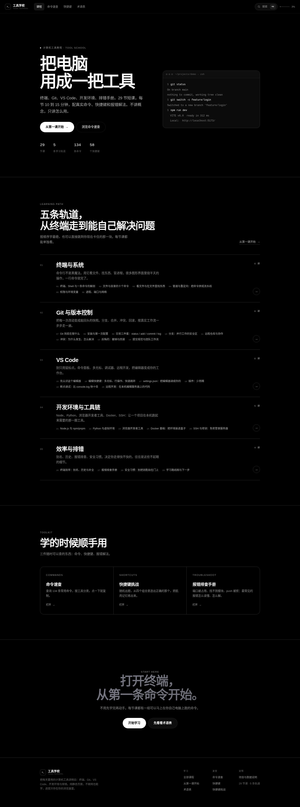
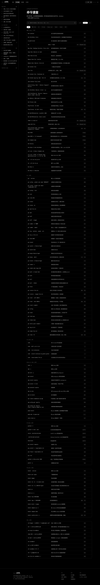
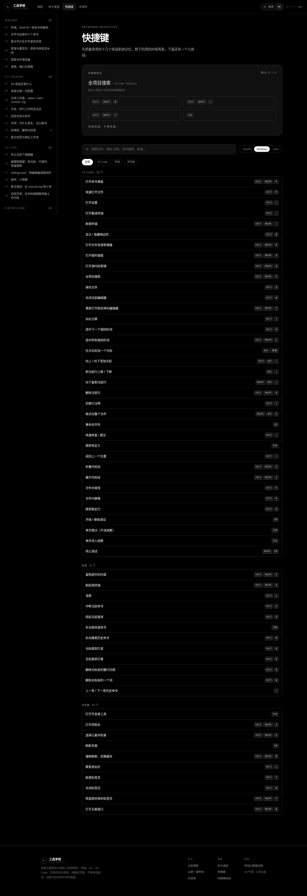
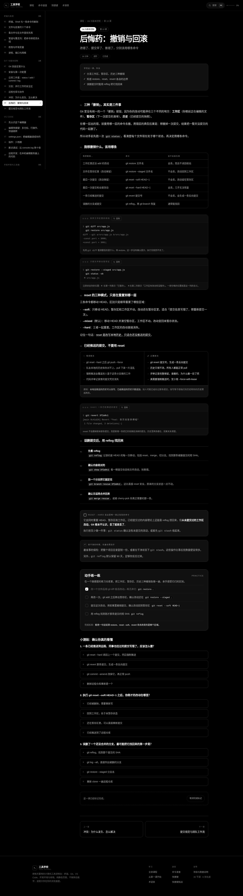

# 工具学校 Tool School

一个纯静态的计算机工具教程网站：**终端、Git、VS Code、开发环境、排错**，29 节短课，每节课配真实命令、快捷键和报错解法。不讲概念，只讲怎么用。



- 29 节课，5 条学习轨道，每节 10 到 18 分钟
- 134 条常用命令、58 个快捷键、28 条术语，随时可查
- 每节课都有「动手练一练」，勾选后保存在本地
- 每节课 3 道小测验，全部答对自动标记完成
- ⌘K / Ctrl+K 全局搜索课程、命令和页面
- 纯静态、零依赖、离线可用；学习进度只存在你自己的浏览器里

配套的 Markdown 版指南：[Xiaopi-Tool-Guide](https://github.com/xiaopi668/Xiaopi-Tool-Guide)，同样的 29 节内容，适合通读、离线阅读或放进团队文档。

## 怎么打开

不需要安装、不需要联网、不需要构建：

- 直接双击 `index.html`，用浏览器打开；
- 或者在目录里起一个静态服务：`python3 -m http.server 8000`，再访问 http://localhost:8000

## 课程

### 终端与系统

| # | 课程 | 时长 |
| --- | --- | --- |
| 1 | 终端、Shell 与一条命令的解剖 | 10 分钟 |
| 2 | 文件与目录的十个命令 | 12 分钟 |
| 3 | 看文件与在文件里找东西 | 14 分钟 |
| 4 | 管道与重定向：把命令拼成流水线 | 14 分钟 |
| 5 | 权限与环境变量 | 15 分钟 |
| 6 | 进程、端口与网络 | 15 分钟 |

### Git 与版本控制

| # | 课程 | 时长 |
| --- | --- | --- |
| 7 | Git 到底在管什么 | 12 分钟 |
| 8 | 安装与第一次配置 | 12 分钟 |
| 9 | 日常三件套：status / add / commit / log | 15 分钟 |
| 10 | 分支：并行工作的安全区 | 14 分钟 |
| 11 | 远程仓库与协作 | 15 分钟 |
| 12 | 冲突：为什么发生、怎么解决 | 15 分钟 |
| 13 | 后悔药：撤销与回滚 | 18 分钟 |
| 14 | 提交规范与团队工作流 | 15 分钟 |

### VS Code

| # | 课程 | 时长 |
| --- | --- | --- |
| 15 | 先认识这个编辑器 | 10 分钟 |
| 16 | 编辑快捷键：多光标、行操作、快速跳转 | 14 分钟 |
| 17 | settings.json：把编辑器调成你的 | 12 分钟 |
| 18 | 插件：少而精 | 14 分钟 |
| 19 | 断点调试：比 console.log 快十倍 | 16 分钟 |
| 20 | 远程开发：在本机编辑服务器上的代码 | 15 分钟 |

### 开发环境与工具链

| # | 课程 | 时长 |
| --- | --- | --- |
| 21 | Node.js 与 npm/pnpm | 15 分钟 |
| 22 | Python 与虚拟环境 | 14 分钟 |
| 23 | 浏览器开发者工具 | 15 分钟 |
| 24 | Docker 基础：把环境装进盒子 | 16 分钟 |
| 25 | SSH 与密钥：免密登录服务器 | 14 分钟 |

### 效率与排错

| # | 课程 | 时长 |
| --- | --- | --- |
| 26 | 终端效率：别名、历史与补全 | 12 分钟 |
| 27 | 报错排查手册 | 16 分钟 |
| 28 | 安全习惯：别把钥匙贴在门上 | 12 分钟 |
| 29 | 学习路线图与下一步 | 10 分钟 |

## 三个常驻工具

**命令速查**（`#/commands`）：134 条命令按工具分组，支持按工具筛选、关键词搜索，并可在 macOS / Windows / Linux 之间切换查看对应写法（Windows 一列默认 PowerShell），右侧一键复制。危险命令带「危险」标签。



**快捷键挑战**（`#/shortcuts`）：58 个快捷键分 macOS / Windows / Linux 三套展示，下面是一个随机出题的训练器——从四个组合里选出正确的那个，答完立刻看得分。



**升级版搜索**：⌘K / Ctrl+K 打开命令面板，可以搜课程标题、命令和页面，方向键选择、回车跳转。



## 设计

界面参考了「纯黑画布 + 发丝线 + 排版驱动」的设计语言：

- 底色是纯黑 `#000`，卡片 `#0a0a0a` 到 `#171717`，全站统一 1px 发丝线 `rgba(255,255,255,.1)`
- 彩色只出现在内容里（终端输出、代码块），界面本身只有黑白灰
- 玻璃只用在「浮在内容之上」的位置：顶栏、搜索框、命令面板；并且是哑光的，没有高光、亮边和彩虹描边
- 顶栏用 9 层递进模糊（blur 10px → 0），解决单层大模糊在深色底上的边缘硬切
- 大标题用负字距（`-0.055em`），中文行高单独放宽到 1.2
- 元素进入视口时淡入上移：IntersectionObserver 触发、同组错峰 70ms、位移用 `translate` 属性以免占用 `transform`，并尊重 `prefers-reduced-motion`

设计令牌在 `assets/css/tokens.css`，玻璃组件在 `assets/css/glass.css`，页面组件在 `assets/css/app.css`。

## 目录结构

```
index.html                  页面骨架
assets/css/tokens.css       设计令牌与排版刻度
assets/css/glass.css        液态玻璃组件（顶栏 / 胶囊 / 递进模糊）
assets/css/app.css          页面组件与响应式
assets/js/data-terminal.js  终端轨道 6 课
assets/js/data-git.js       Git 轨道 8 课
assets/js/data-vscode.js    VS Code 轨道 6 课
assets/js/data-dev.js       开发环境轨道 5 课
assets/js/data-efficiency.js 效率与排错轨道 4 课
assets/js/data-refs.js      命令 / 快捷键 / 术语数据
assets/js/app.js            路由、渲染、进度、搜索面板、训练器
tools/check-data.mjs        课程数据契约校验
tools/verify.mjs            端到端自检（真实浏览器）
SCHEMA.md                   课程数据字段契约
screenshots/                页面截图
```

## 加一课

课程内容是数据，不是页面。照着 `SCHEMA.md` 在对应的 `data-*.js` 里追加一个对象，刷新就会出现在首页、侧边栏和上一课 / 下一课导航里。

支持 9 种内容块：`text`、`tip`、`warn`、`steps`、`table`、`code`、`terminal`、`shortcuts`、`compare`。

## 自检

```
node tools/check-data.mjs     # 校验全部课程是否符合数据契约
node tools/verify.mjs         # 需要浏览器暴露 CDP 端口：默认 9222
node tools/verify.mjs --shots # 顺便把各页面截图写到 screenshots/
```

`verify.mjs` 会在 9222 端口新建一个标签页，跑完自动关闭。没有现成浏览器时可以先启动一个：

```
chrome --headless=new --remote-debugging-port=9222 --user-data-dir=/tmp/ts-profile about:blank
```

当前 33 项检查全部通过：数据契约、29 课逐课渲染、测验与自动完成、练习勾选与本地保存、复制反馈、命令筛选与搜索、快捷键挑战、平台切换、⌘K 面板、术语表、移动端目录、滚动入场动画（触发、错峰、降级），以及运行期零 JS 报错。

## 说明

内容为工具用法教学，命令与快捷键按 macOS 与 Windows 分别标注。危险命令（`rm -rf`、`reset --hard`、`chmod 777`、`prune -a`）在正文与速查表里都标了后果，练习请在空目录或测试仓库里做。
